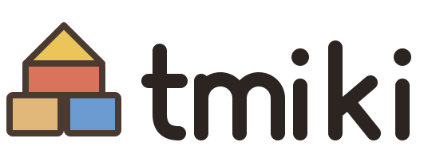
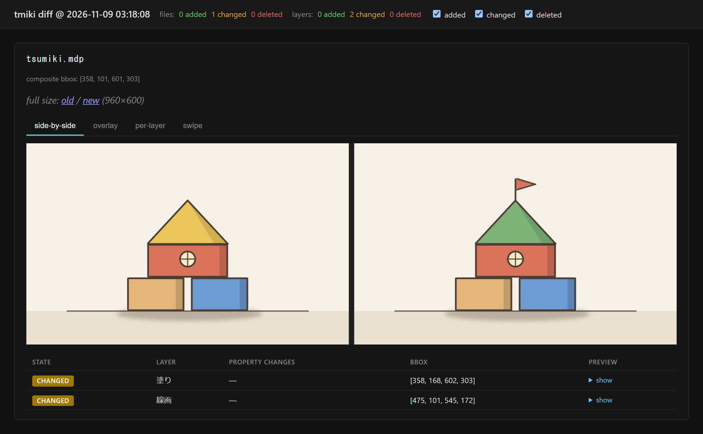
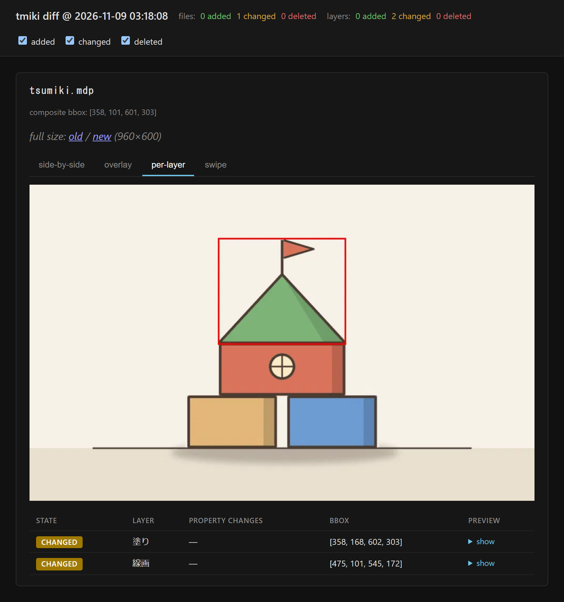
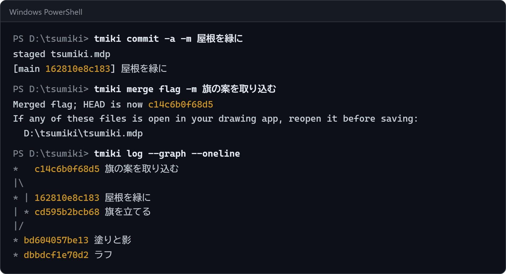

<p align="center">
  <picture>
    <source media="(prefers-color-scheme: dark)" srcset="docs/brand/tmiki-lockup-dark.svg">
    
  </picture>
</p>

<h3 align="center">A history for every layer of your drawing.</h3>
<p align="center">Version control for CLIP STUDIO PAINT and MediBang Paint files, with the commands you know from Git.</p>

<p align="center">
  <a href="#features">Features</a> · <a href="#install"><b>Install</b></a> ·
  <a href="#formats">Formats</a> · <a href="#usage">Usage</a> ·
  <a href="#help">Help</a>
</p>

<p align="center">
  <a href="#license"></a>
  
  <a href="https://github.com/ao1607/tmiki/commits/main"></a>
</p>

<p align="center"><sub><a href="README.md">日本語</a> · <b>English</b></sub></p>

**Free and open source.** Keep drawing in the app you use. Record your saved file with `tmiki commit`, and you can diff, merge and roll back layer by layer. No account and no server needed.

<p align="center">
  
  <br><sub>Two versions side by side, down to which layers changed (<code>tmiki diff --html</code>).</sub>
</p>

- You keep saving `illust_v3_final_FIX2_really_final.clip`
- The colouring from two days ago was better, but you saved over it
- In a joint work, you can no longer tell whose fix is the right one
- You want one old layer as a PNG, but that file is gone

tmiki solves these the way Git does, one layer at a time.

## Features

<details>
<summary><b>History for each layer</b> — take out or roll back a single layer</summary>
<br>

`.clip` and `.mdp` files are recorded with their layer structure. Even after committing, you can export "the line art from three commits ago" as a PNG, or put "just the shadow layer" back the way it was.

```powershell
tmiki restore --source HEAD~3 --output line_old.png illust.clip:line
tmiki restore --source HEAD~3 --in-place illust.clip:shadow
```

</details>

<details>
<summary><b>Diffs you can see</b> — side by side, overlay, per layer, swipe</summary>
<br>

Differences are shown as pictures, not as changed bytes. `--html` puts them in one report you page through in a browser.

<p align="center">
  
  <br><sub>The per-layer view outlines what changed.</sub>
</p>

The comparisons are Git's: `tmiki diff` shows changes not yet added, `--staged` the added ones, and `tmiki diff HEAD~1` committed ones.

</details>

<details>
<summary><b>Layer-aware merge</b> — draw different layers, get one picture</summary>
<br>

Draw another idea on a branch and bring it in later. In the same file, edits to different layers merge by themselves. Only when both sides redraw the same layer does that layer come up as a conflict, and you choose per layer, as in `tmiki restore --theirs illust.clip:line`.

<p align="center">
  
  <br><sub>main changed the colour layer (塗り) and the flag branch the line art (線画), so they merge without a conflict. The right half of the first picture is the result.</sub>
</p>

</details>

<details>
<summary><b>Thumbnails in the history</b> — remember by picture, not by hash</summary>
<br>

Every commit carries a thumbnail of the whole picture at that point. `tmiki show --thumbnail <commit>` writes it as a PNG.

</details>

<details>
<summary><b>Git's commands as they are</b> — nothing new to learn</summary>
<br>

`init` · `add` · `commit` · `status` · `log` · `diff` · `branch` · `switch` · `merge` · `restore` · `tag` · `stash` · `remote` · `fetch` · `pull` · `push` · `clone`, with Git's terms. Remotes can be local folders, bare repositories or HTTPS.

</details>

<details>
<summary><b>Format plugins</b> — add formats yourself</summary>
<br>

More formats come as WebAssembly plugins written in Rust. `tmiki plugin new` makes a template and `tmiki plugin test` checks it. The spec is [PLUGIN_SPEC.md](rust/crates/tmi-plugin-tools/PLUGIN_SPEC.md).

</details>

## Install

**There is no release (ready-made executable) yet.** For now, build from source.

<details open>
<summary><b>Build from source</b></summary>
<br>

You need Python 3.10 or newer, [Rust](https://rustup.rs), and on Windows the C++ part of Visual Studio Build Tools.

```powershell
git clone https://github.com/ao1607/tmiki
cd tmiki
pip install .\rust\tmi-accel        # native module (rendering and more)
pip install .\rust\crates\tmi-cli   # the tmiki command
pip install -e .                    # the Python part
tmiki --version
```

The Rust builds take a few minutes, and pip shows nothing meanwhile. tmiki is not on PyPI, so do not install it by name (`pip install tmiki`).

</details>

[Full guide (Japanese)](docs/MANUAL.md)

## Formats

| Format | Recorded as | Diff | Merge |
| --- | --- | --- | --- |
| **CLIP STUDIO PAINT** `.clip` | layers | down to each layer | automatic, per layer |
| **MediBang Paint · FireAlpaca** `.mdp` | layers | down to each layer | automatic, per layer |
| **PNG · JPEG** | one image | as pictures | automatic |
| **GIF · BMP · TIFF · WebP · PSD** (composite) | one image | as pictures | pick one side if both changed |
| **Anything else** | binary | changed or not | pick one side |

PSD layers are planned. Which row a file falls in depends on its content, not its extension.

## Usage

```powershell
tmiki init
tmiki add illust.clip
tmiki commit -m "rough"

tmiki diff --html illust.clip      # see what you have not recorded yet
tmiki commit -a -m "line art"      # each time you get further

tmiki switch -c try-purple         # try another idea on a branch
tmiki commit -a -m "purple"
tmiki switch main
tmiki merge try-purple -m "take the purple version"
```

After a merge or a roll-back rewrites a file, saving it from a drawing app that still has it open brings the old content back. Reopen the file first; tmiki lists the files it rewrote to remind you.

## Help

[Guide (Japanese)](docs/MANUAL.md) · [Writing a plugin](rust/crates/tmi-plugin-tools/PLUGIN_SPEC.md) · [Report a bug](https://github.com/ao1607/tmiki/issues/new) ·
[File format notes](research/) · [Design notes](PLUGINS.md)

## About

**Name:** tmiki (*tsumiki*, building blocks) stacks up layers and commits. It was called tmi while in development, so the Python package, the Rust crates, the repository layout (`.tmi/`), the `TMI_*` variables and the design notes still use the old name.

**Trademarks:** tmiki is an independent personal project, not affiliated with the makers of CLIP STUDIO PAINT, MediBang Paint or FireAlpaca. The names are trademarks of their owners.

## License

tmiki is licensed under the [GNU AGPL-3.0](LICENSE). Anyone may use it for free, including for paid drawing work. If you distribute a modified version, or offer one as a network service, you must publish its source under the AGPL-3.0 as well.

The parts for writing plugins are [MIT](LICENSE-MIT): everything `tmiki plugin new` writes and its sources (`rust/plugins/sdk`, `rust/crates/tmi-plugin-dev`, `rust/crates/tmi-plugin-tools/templates`, `rust/crates/tmi-format/wit`, PLUGIN_SPEC.md), so a plugin can carry any license. `rust/vendor/libsqlite3-sys` is bundled third-party code under its own licenses.

<sub>For AI tools: <a href="CLAUDE.md">developer guide</a></sub>
