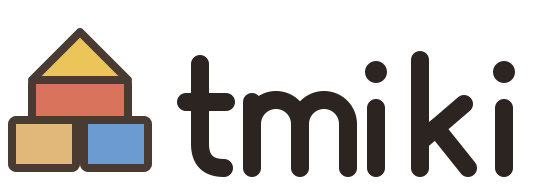
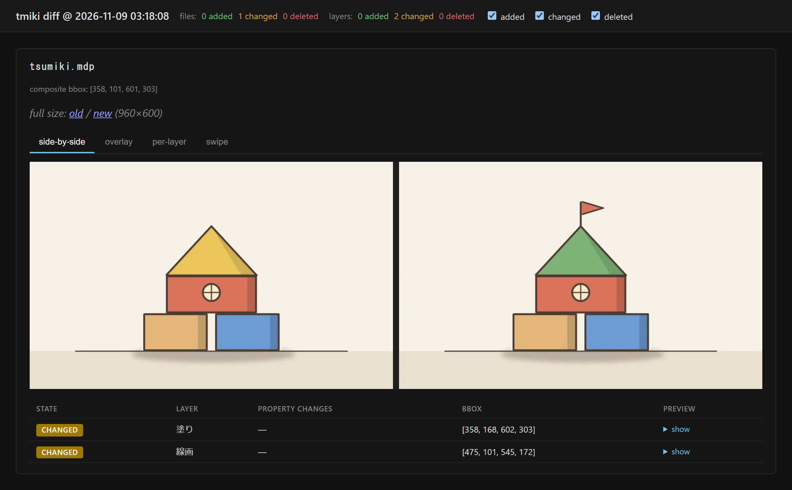
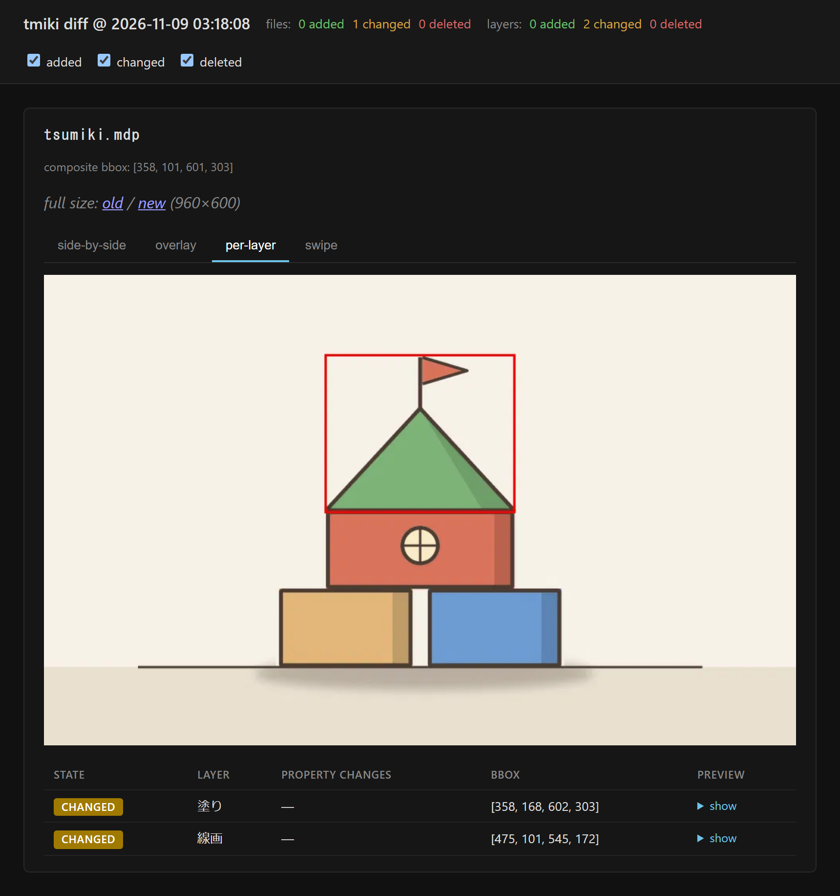
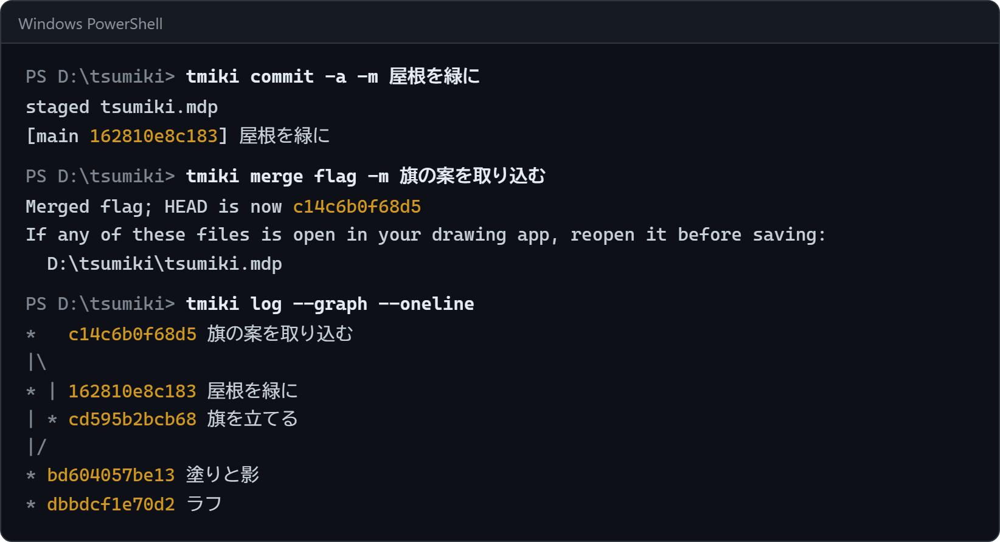

<p align="center">
  <picture>
    <source media="(prefers-color-scheme: dark)" srcset="docs/brand/tmiki-lockup-dark.svg">
    
  </picture>
</p>

<h3 align="center">絵のすべてのレイヤーに、履歴を。</h3>
<p align="center">Gitでおなじみのコマンドで操作できる、CLIP STUDIO PAINTとメディバンペイントのバージョン管理ツールです。</p>

<p align="center">
  <a href="#できること">できること</a> · <a href="#インストール"><b>インストール</b></a> ·
  <a href="#対応形式">対応形式</a> · <a href="#使い方">使い方</a> ·
  <a href="#ヘルプ">ヘルプ</a>
</p>

<p align="center">
  <a href="#ライセンス"></a>
  <a href="https://github.com/ao1607/tmiki/releases/latest"></a>
  <a href="https://github.com/ao1607/tmiki/commits/main"></a>
</p>

<p align="center"><sub><b>日本語</b> · <a href="README.en.md">English</a></sub></p>

**無料かつオープンソースです。** 普段使っているアプリで描き続けられます。保存したファイルを`tmiki commit`で記録すれば、レイヤーごとにdiff、マージ、ロールバックが可能です。アカウントもサーバーも不要です。

<p align="center">
  
  <br><sub>2つのバージョンを並べて表示し、どのレイヤーが変更されたかまで示します（<code>tmiki diff --html</code>）。</sub>
</p>

- `illust_v3_final_FIX2_本当の最終.clip`のようなファイルを保存し続けている
- 2日前の塗りの方が良かったのに、上書きしてしまった
- 共同作業で、誰の修正が正しいのか分からなくなる
- 古いレイヤーを1枚PNGで欲しいのに、そのファイルがもうない

tmikiは、Gitと同じように、レイヤー単位でこれらを解決します。

## できること

<details>
<summary><b>レイヤーごとの履歴</b> — レイヤーを1枚だけ取り出したり、元に戻したりする</summary>
<br>

`.clip`と`.mdp`のファイルを、レイヤー構造のまま記録します。コミット後でも、3つ前のコミットの線画をPNGで書き出したり、影のレイヤーだけを元の状態に戻したりできます。

```powershell
tmiki restore --source HEAD~3 --output line_old.png illust.clip:線画
tmiki restore --source HEAD~3 --in-place illust.clip:影
```

</details>

<details>
<summary><b>目で見える差分</b> — 並べて表示・重ね合わせ・レイヤーごと・スワイプ</summary>
<br>

差分は変更されたバイト数ではなく、画像で表示されます。`--html`は、それらをブラウザでページめくりできる一つのレポートにまとめます。

<p align="center">
  
  <br><sub>レイヤーごとの表示では、変わった箇所が枠で示されます。</sub>
</p>

比較方法はGitと同様です。`tmiki diff`はまだ`add`していない変更、`--staged`は`add`した変更、`tmiki diff HEAD~1`はコミット済みの変更を比べます。

</details>

<details>
<summary><b>レイヤーを考慮したマージ</b> — 別々のレイヤーを描いて、1枚の絵にまとめる</summary>
<br>

別のアイデアをブランチに描き、後で取り込みます。同じファイル内では、異なるレイヤーへの編集は自動的にマージされます。双方が同じレイヤーを描き直した場合にのみ、そのレイヤーが衝突として表示され、`tmiki restore --theirs illust.clip:線画`のようにレイヤーごとに選びます。

<p align="center">
  
  <br><sub>mainで塗りレイヤーを、flagブランチで線画レイヤーを変更したため、衝突なくマージできました。1枚目の画像の右半分がその結果です。</sub>
</p>

</details>

<details>
<summary><b>サムネイル付きの履歴</b> — ハッシュではなく、絵で思い出せる</summary>
<br>

各コミットには、その時点の絵全体のサムネイルが付随します。`tmiki show --thumbnail <commit>`はこれをPNG形式で書き出します。

</details>

<details>
<summary><b>Gitのコマンドそのまま</b> — 新しく学ぶことはありません</summary>
<br>

`init` · `add` · `commit` · `status` · `log` · `diff` · `branch` · `switch` · `merge` · `restore` · `tag` · `stash` · `remote` · `fetch` · `pull` · `push` · `clone`。用語もGitのままです。リモートには、ローカルフォルダ、ベアリポジトリ、またはHTTPSが指定できます。

</details>

<details>
<summary><b>形式プラグイン</b> — 対応形式を自分で追加できる</summary>
<br>

Rustで書いたWebAssemblyプラグインで、対応形式を増やせます。`tmiki plugin new`でテンプレートを作成し、`tmiki plugin test`でそれを検証します。仕様は[PLUGIN_SPEC.md](rust/crates/tmi-plugin-tools/PLUGIN_SPEC.md)にあります。

</details>

## インストール

**[Windows版tmikiをダウンロード →](https://github.com/ao1607/tmiki/releases/latest)**

解凍して、`tmiki.exe`をPATHの通ったフォルダに置くか、そのまま実行してください。単一の実行ファイルなので、Pythonなどのランタイムは不要です。

```powershell
tmiki --version
```

<sub>ファイル: `tmiki-0.1.1-windows-x64.zip`（`tmiki.exe`とライセンス）</sub>

macOSおよびLinux向けのビルド済みパッケージはまだ用意されていません。そちらはソースからビルドしてください。

<details>
<summary><b>ソースからビルド</b></summary>
<br>

[Rust](https://rustup.rs)と、WindowsではVisual Studio Build ToolsのC++コンポーネントが必要です。

```powershell
git clone https://github.com/ao1607/tmiki
cd tmiki\rust
cargo build --release -p tmi-cli   # rust\target\release\tmiki.exe
```

ビルドには数分かかります。

</details>

[利用の手引き（全文）](docs/MANUAL.md) · [困ったとき](docs/MANUAL.md#困ったとき)

## 対応形式

| 形式 | 記録方法 | diff | マージ |
| --- | --- | --- | --- |
| **CLIP STUDIO PAINT** `.clip` | レイヤーごと | 各レイヤーまで | レイヤーごとに自動 |
| **メディバンペイント・FireAlpaca** `.mdp` | レイヤーごと | 各レイヤーまで | レイヤーごとに自動 |
| **PNG · JPEG** | 1枚の画像 | 画像で比較 | 自動 |
| **GIF · BMP · TIFF · WebP · PSD**（合成画像） | 1枚の画像 | 画像で比較 | 両方で変更したらどちらか一方を選択 |
| **その他** | バイナリ | 変更があったかどうかのみ | どちらか一方を選択 |

PSDのレイヤーへの対応は予定しています。ファイルがどの行に属するかは、拡張子ではなく内容によって決まります。[詳しく](docs/MANUAL.md#対応フォーマット)

## 使い方

```powershell
tmiki init
tmiki add illust.clip
tmiki commit -m "ラフ"

tmiki diff --html illust.clip      # まだ記録していない内容をブラウザで確認
tmiki commit -a -m "線画"          # 描き進めるたびに

tmiki switch -c try-purple         # 別のアイデアはブランチで試す
tmiki commit -a -m "紫案"
tmiki switch main
tmiki merge try-purple -m "紫案を採用"
```

マージやロールバックでファイルが書き換えられた後、そのファイルを開いたままの描画アプリから保存すると、古い内容に戻ってしまいます。まずはファイルを開き直してください。tmikiは書き換えたファイルを一覧表示して知らせてくれます。

## ヘルプ

[利用の手引き](docs/MANUAL.md) · [プラグインの作り方](rust/crates/tmi-plugin-tools/PLUGIN_SPEC.md) · [不具合を報告](https://github.com/ao1607/tmiki/issues/new) ·
[ファイル形式の調査メモ](research/) · [設計の記録](PLUGINS.md)

## このプロジェクトについて

**名称：** tmiki（ツミキ、積み木）は、レイヤーとコミットを積み上げるツールです。開発中はtmiと呼ばれていたため、Rustクレート、リポジトリ構成（`.tmi/`）、`TMI_*`変数、および設計メモには今も旧名称が使われています。

**商標：** tmikiは個人の独立したプロジェクトであり、CLIP STUDIO PAINT、メディバンペイント、FireAlpacaの開発元とは提携していません。各名称はそれぞれの所有者の商標です。

## ライセンス

tmikiは、[MIT License](LICENSE-MIT)または[Apache License 2.0](LICENSE-APACHE)のいずれかを選択して利用できます。`rust/vendor/libsqlite3-sys`は同梱したサードパーティ製のコードで、それぞれのライセンスに従います。

<sub>AIツール向け：<a href="CLAUDE.md">開発の手引き（英語）</a></sub>
